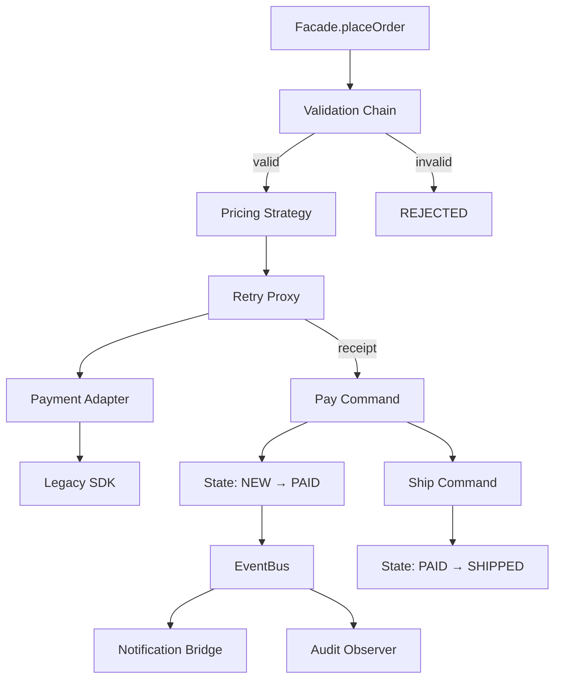

# 第 21 章：综合实战——可观测订单履约系统

## 1. 用户与场景

电商前台提交订单后，系统需要校验输入、计算会员价、调用接口不兼容且偶发失败的支付 SDK、驱动订单状态、发布业务事件，并通过不同通道通知用户。调用方只使用一个 `OrderSystemFacade.placeOrder()` 入口。

系统是纯内存、单进程演示，重点是模式如何围绕**真实变化点**协作，而不是模拟生产基础设施。

## 2. 输入、输出与边界

| 项目 | 约定 |
|---|---|
| 金额 | `long` 表示最小货币单位（分），避免浮点误差 |
| 正常输入 | 非空客户、至少一个库存充足且数量为正的商品 |
| 成功输出 | `SUCCESS`、最终金额、支付尝试次数、订单 `SHIPPED` |
| 校验失败 | `REJECTED`，不调用支付、不改变订单状态 |
| 短暂支付失败 | 重试代理最多尝试 2 次；成功后继续履约 |
| 持久支付失败 | 工作流返回 `FAILED`，命令总线逆序补偿已执行命令 |

## 3. 模式—角色映射

| 模式 | 代码角色 | 解决的变化 |
|---|---|---|
| Builder | `Order.Builder` | 订单行项目分步构造与不变量 |
| Strategy | `PricingStrategy` / `VipPricingStrategy` | 定价算法可替换 |
| Chain of Responsibility | `ValidationHandler` 子类 | 校验规则与顺序可配置 |
| Adapter | `LegacyPaymentAdapter` | 领域支付接口与旧 SDK 协议不兼容 |
| Proxy | `RetryingPaymentProxy` | 透明重试、尝试次数观测 |
| Template Method | `CheckoutWorkflow.checkout()` | 固定履约骨架，开放定价与完成钩子 |
| Command | `PayOrderCommand`、`ShipOrderCommand` | 操作封装、历史与逆序补偿 |
| State | `NewState`、`PaidState`、`ShippedState` | 合法状态行为与内部转移 |
| Observer | `EventBus` / `DomainObserver` | 状态变化广播给未知数量订阅者 |
| Bridge | `OrderNotification` + `MessageSender` | 消息内容与发送通道独立演化 |
| Facade | `OrderSystemFacade` | 面向客户端提供一个粗粒度入口 |
| Singleton | `MetricsRegistry.INSTANCE` | 当前进程的统一计数入口 |

## 4. 控制流



## 5. 运行与验收

在代码库根目录运行：

```powershell
# 主流程：支付一次成功
.\scripts\run.ps1 21

# 故障注入：旧 SDK 第一次失败，代理检测并重试，第二次恢复
.\scripts\run.ps1 21 --fail-payment

# 边界输入：空客户名称，责任链拒绝且支付调用次数为 0
.\scripts\run.ps1 21 --invalid-order
```

三条命令都以 `[PASS] chapter-21` 结束，因为后两条的故障与拒绝是**预期且已验证的业务结果**。正常/恢复路径的关键结果：

```text
status=SUCCESS
order.state=SHIPPED
notifications=2
audit.events=2
```

## 6. 故障发现、止损、恢复、复盘

1. **发现**：代理记录 `payment-attempt=N` 与失败原因；指标记录请求、重试和成功数。
2. **止损**：最大尝试次数固定为 2，校验失败时不触碰外部支付；工作流捕获支付失败并结束。
3. **恢复**：对瞬时错误在同一请求中重试；状态操作以命令保存前态，可逆序补偿。
4. **复盘**：比较 `payment.attempts`、`payment.retries` 与业务事件数量；同一故障模式有自动断言防回归。

## 7. 取舍与进阶

- 当前 `EventBus` 同步执行，简单且顺序确定；高吞吐场景可换成异步队列，但必须补充重试、幂等和背压。
- 内存命令补偿不等于数据库事务；跨服务可靠性应采用 Outbox/Saga，并用业务幂等键处理重复消息。
- 枚举指标注册表便于教学，但生产系统应注入标准 Metrics 接口以隔离测试和接入监控后端。
- 下一步只选一个维度测量：例如用同一批订单测 P95 延迟，再决定是否异步化通知。

