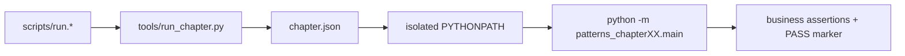

# Python 版架构与目录

```text
design-patterns-python/
├── pyproject.toml
├── chapters/
│   └── XX-topic/
│       ├── chapter.json
│       ├── README.md
│       └── src/patterns_chapterXX/
│           ├── __init__.py
│           └── main.py
├── docs/
├── scripts/
└── tools/
```



章节包彼此不在对方 `PYTHONPATH` 中，因此不会产生隐式跨章依赖。第 21 章使用多个源码模块表达综合领域，但仍不引用前 20 章的教学类型。

